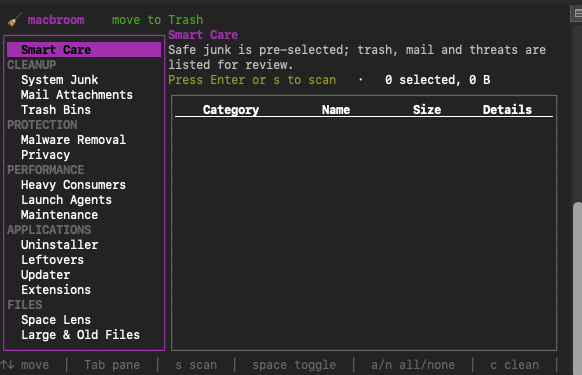
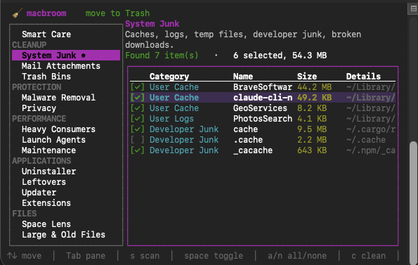

#  Macbroom

A fast, low-memory, CleanMyMac-style cleaner & optimizer for macOS, written in Rust.
Single 1.5 MB binary · ~3 MB RAM idle · ~25 MB peak while scanning · 0% CPU when idle.

## Screenshots

| Smart Care | System Junk |
| :---: | :---: |
|  |  |

## Install

**DMG:** run `./scripts/build-dmg.sh`, open `dist/macbroom-0.1.0.dmg`, and drag
`macbroom.app` to Applications. Double-clicking it opens the app in Terminal.
Optional command-line access:
`sudo ln -sf /Applications/macbroom.app/Contents/Resources/macbroom /usr/local/bin/macbroom`

**From source:**

```bash
cargo build --release
cp target/release/macbroom /usr/local/bin/
```

> Grant **Full Disk Access** to your terminal (System Settings → Privacy & Security)
> so Safari, Mail and Trash data can be scanned.

## Usage

```bash
macbroom            # interactive app (TUI)
macbroom scan       # Smart Care report (dry run)
macbroom scan --yes # clean the pre-selected items (moves to Trash)
```

Every command is a **dry run** unless you pass `--yes`.
Shared flags: `--all` (include unselected items), `--only <text>` (pick by name),
`--permanent` (skip Trash), `-v` (list everything).

| CleanMyMac feature | macbroom | Notes |
|---|---|---|
| Smart Care | `scan` | junk + trash + mail + threats |
| System Junk | `junk` | user caches, logs, saved state, temp (>3 days), Xcode/npm/pnpm/cargo/gradle caches, broken downloads; installers, Xcode archives, iOS backups listed unselected |
| Mail Attachments | `mail` | |
| Trash Bins | `trash` | home + external volumes |
| Malware Removal | `malware` | heuristic: known adware families, unsigned/hidden/temp/orphaned launch items |
| Privacy | `privacy` | Chrome, Brave, Edge, Vivaldi, Arc, Safari, Firefox history/cookies/cache; recent items |
| Heavy Consumers | `top` | `top --only Chrome --yes` quits it |
| Login/Launch Agents | `agents` | disable is reversible (`launchctl enable …`) |
| Maintenance | `maintain` | free RAM, flush DNS, thin TM snapshots, reindex Spotlight, font caches, home permissions, Launch Services, verify disk, restart Finder/Dock, periodic scripts |
| Uninstaller | `apps` | `apps --only Slack --yes` removes app + leftovers |
| Leftovers | `leftovers` | data from already-deleted apps (verified via Spotlight) |
| Updater | `updates` | Homebrew formulae/casks, `mas` App Store apps, macOS |
| Extensions | `extensions` | Quick Look, pref panes, plug-ins, screen savers, audio drivers |
| Space Lens | `space [path]` | TUI: Enter opens folder, Backspace goes up |
| Large & Old Files | `large [path] --min-size 100MB --older-than 365` | |
| Duplicates | `dupes [path] --min-size 1MB` | xxh3 content hash, oldest copy kept |
| Shredder | `shred <path> --yes` | overwrite + unlink (see SSD caveat) |
| Menu monitor | `monitor` | CPU, cores, RAM, swap, disk, network, CPU temp, battery + health |

## TUI keys

`↑↓/jk` move · `Tab/←→` switch pane · `Enter` scan/open · `s` rescan · `space` toggle ·
`a`/`n` select all/none · `c` run action · `p` toggle permanent delete · `?` help · `q` quit

## Safety

- Files go to the **Trash** by default (Trash bins themselves are emptied permanently).
- A guard refuses system paths (`/System`, `/usr`, …), your home/Library roots, and anything outside home, `/Applications`, `/Library`, `/Users/Shared`, temp and `/Volumes`.
- Apple caches, SIP-protected apps and anything risky (backups, privacy data, apps, agents) are never pre-selected.
- Root tasks use the native macOS password dialog, batched into one prompt.
- Malware detection is heuristic, not a signature engine. macOS XProtect still runs.
- Shredding cannot guarantee erasure on SSD/APFS; FileVault is the real protection.

## Not included (vs CleanMyMac)

Similar-photo detection, cloud-drive cleanup, a native menu-bar app, and app-permission management.

## Development

```bash
cargo test              # 85 tests (unit + read-only integration against your Mac)
cargo llvm-cov --summary-only   # ~90% line coverage
```
